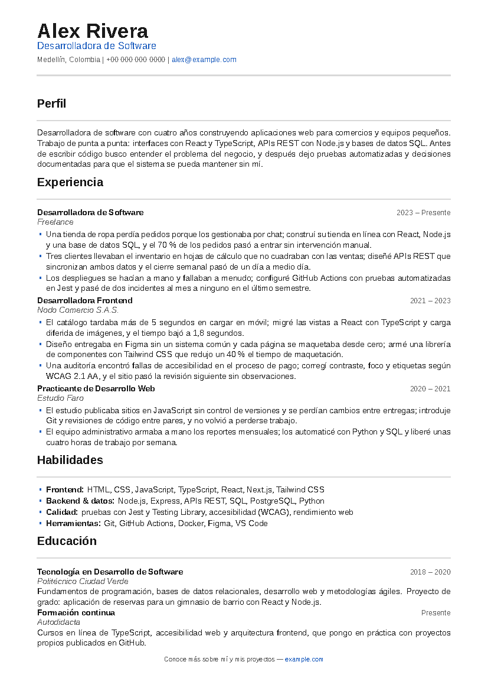

<p align="center">
  
</p>

# Career Kit

**Escribe tu hoja de vida una sola vez y saca de ahí un PDF por idioma y por perfil.**

Career Kit es gratis, de código abierto, está en español y lo hizo un colombiano para
personas en Colombia. Tu hoja de vida vive en un archivo, `content/<persona>/cv.json`;
de ahí salen los PDF y se comprueba que un ATS (el sistema que filtra hojas de vida)
pueda leerlos. No es un editor visual: hay un solo diseño y los datos se escriben en
JSON.

Estado al 2026-11-24: funciona en local, compilando con Docker. La integración
continua (CI) está escrita, pero todavía no ha corrido en GitHub.



*Primera página del PDF `es/software-developer` de Alex Rivera, la persona ficticia de
`content/example`.*

## Hazla sin instalar nada

Todo corre en GitHub, desde el navegador. La [guía paso a paso](docs/guia.md) está
escrita para quien no programa.

1. [Crea tu copia **privada**](docs/guia.md#paso-1-crea-tu-copia-privada) desde la plantilla.
2. [Copia `content/example` y edita tu `cv.json`](docs/guia.md#paso-2-crea-tu-carpeta-y-edita-tu-cvjson) en el navegador.
3. [Descarga tus PDF](docs/guia.md#paso-3-descarga-tus-pdf) de la pestaña «Actions».

## En tu equipo

Requisitos:

- Python 3. Los scripts no tienen dependencias externas.
- Docker, o XeLaTeX instalado. Con XeLaTeX local se usa ese; si no hay, `build.sh`
  compila dentro de la imagen de TeX Live fijada en `scripts/texlive-image.txt`, sin
  red (la imagen se descarga la primera vez).
- `pdftotext` (poppler-utils), sólo para la comprobación ATS.

Los comandos se lanzan desde la raíz del repo y con `-m`. En macOS y Linux escribe
`python3` donde aquí dice `py`.

| Comando | Qué hace |
|---|---|
| `bash scripts/build.sh content/<persona>` | Genera los `.tex` y compila los PDF en `builds/<persona>/out/`. Sin argumento usa `content/example` |
| `py -m scripts.render content/<persona>` | Valida el `cv.json` y genera sólo los `.tex`, en `builds/<persona>/` |
| `py -m scripts.check_all content/<persona>` | Comprueba el ATS de cada PDF ya compilado en `builds/<persona>/out/`. Sale con 1 si alguno falla |
| `py -m scripts.cli` | Menú: generar tus hojas de vida o adaptar una a una vacante |
| `py -m scripts.generate_cv content/example --variant es/software-developer --job-file vacante.txt` | Adapta esa variante a la vacante y escribe `builds/example/cv-es-software-developer-vacante.tex` y su `.proposal.json` |
| `py -m unittest discover -s tests` | Corre los tests |
| `py -m scripts.privacy_check` | Busca correos y teléfonos reales en los archivos que git versiona |

Detalles de la adaptación a una vacante:

- Es opcional y usa Groq. Para activarla copia `.env.example` a `.env` y pon tu
  `GROQ_API_KEY`.
- Antes de enviar nada, muestra un aviso y pide confirmar con `s`. Con `--yes` acepta
  sin preguntar, y sin terminal y sin `--yes` no envía nada.
- Si no aceptas, no hay clave o Groq falla, adapta en local, sin salir de tu equipo.
  Si Groq falla, lo marca como `FALLBACK` en la propuesta JSON y en la consola, nunca
  en el PDF.
- Puedes dar la vacante con `--job-description "texto"` en lugar de `--job-file`.
- El comando escribe el `.tex` y la propuesta. Para el PDF:
  `bash scripts/build.sh builds/<persona>/cv-es-software-developer-vacante.tex`, que lo
  deja en `builds/<persona>/out/`.

## Tus datos

- Sólo `content/private/` queda fuera de git (`.gitignore`). Cualquier otra carpeta de
  `content/` se versiona, así que si guardas tu hoja de vida ahí, la copia del
  repositorio debe ser privada.
- La CI compila cada `content/*/` con un `cv.json`, salvo `private`. Una carpeta con
  ese nombre no genera PDF en GitHub.
- Tu `.env` con la clave de Groq también está ignorado por git.
- **A Groq se envía** (sólo si aceptas): el título, el resumen y las keywords del perfil;
  de cada experiencia, el cargo, la organización, las fechas y los logros; las
  habilidades; y el texto de la vacante.
- **A Groq no se envía:** tu nombre, tu teléfono, tu correo ni tu ubicación.
- Qué datos conviene poner y cuáles no (cédula, foto, edad, estado civil...), con su
  porqué: [guía de hoja de vida para Colombia](docs/hoja-de-vida-colombia.md).

## Formato de `cv.json`

Un fragmento de `content/example/cv.json`:

```json
{
  "person": {
    "name": "Alex Rivera",
    "location": {"es": "Medellín, Colombia", "en": "Medellín, Colombia"},
    "phone": "+00 000 000 0000",
    "email": "alex@example.com"
  },
  "experience": [
    {
      "role": {"es": "Desarrolladora de Software", "en": "Software Developer"},
      "organization": "Freelance",
      "start": "2023",
      "end": null,
      "highlights": {
        "es": ["Una tienda de ropa perdía pedidos porque los gestionaba por chat; ..."],
        "en": ["A clothing store was losing orders because it handled them over chat; ..."]
      }
    }
  ],
  "variants": [
    {"lang": "es", "profile": "software-developer"},
    {"lang": "en", "profile": "software-developer"}
  ]
}
```

Cada elemento de `variants` es un PDF: un idioma (`es` o `en`) y un perfil de
`profiles`. El significado de cada campo, en lenguaje llano, está en la
[guía](docs/guia.md#qué-significa-cada-campo).

<details>
<summary>Reglas del formato</summary>

- Campos de primer nivel, todos obligatorios: `person`, `more`, `profiles`,
  `experience`, `skills`, `education` y `variants`.
- Un texto traducible es una cadena (vale para todos los idiomas) o un objeto
  `{"es": "...", "en": "..."}`. Lo mismo para las listas de `highlights` y `keywords`.
  Si una variante usa un idioma, todo objeto traducible que use debe tenerlo.
- `start` y `end` son texto o `null`. `end: null` se muestra como «Presente». Con
  `start: null` sólo se muestra el fin; con los dos en `null`, sale «Presente».
- `subtitle` es opcional en `experience` y `education`.
- `experience[].highlights` debe tener al menos un logro por idioma, y `variants` al
  menos una variante.
- El validador junta todos los errores y dice la ruta exacta del campo, por ejemplo
  `experience[0].highlights.en: falta el texto en 'en' (variante en/software-developer)`.
- No hace falta escapar `&`, `%`, `$`, `#`, `_` ni otros caracteres especiales de
  LaTeX: el renderizador lo hace.
- Las `keywords` de un perfil se buscan en el texto del PDF: si falta una, la
  comprobación ATS falla.
- Cada idioma necesita su `lang/<idioma>.tex` (hoy `es` y `en`).

</details>

<details>
<summary>Estructura del repo</summary>

```
content/example/    cv.json de la persona ficticia; la única que se versiona
content/private/    tu hoja de vida real en local; ignorada por git
docs/               guia.md (paso a paso) y hoja-de-vida-colombia.md
lang/               es.tex y en.tex: etiquetas de la plantilla («Experiencia», «Presente»)
styles/             modern.tex: tipografía, color y espaciado
scripts/            render, build.sh, check_all, ats_check, generate_cv, cli, privacy_check
prompts/            prompt de sistema y plantilla del prompt de usuario para Groq
schemas/            esquema de la respuesta esperada de Groq
tests/              tests de unittest
assets/             banner.svg, preview-es.png y fonts/ (Liberation Sans)
specs/              spec, plan y tareas de la fuente única
.github/workflows/  ci.yml: tests, privacidad, compilación y ATS
Makefile            atajos: make build PERSON=content/<persona>, make list, make clean
.env.example        plantilla de variables de Groq
builds/             salida generada (ignorada por git)
```

</details>

---

Tipografía Liberation Sans (SIL OFL 1.1) · [Licencia MIT](LICENSE) · Hecho por Luis Rodríguez · [neobmo.github.io](https://neobmo.github.io)
